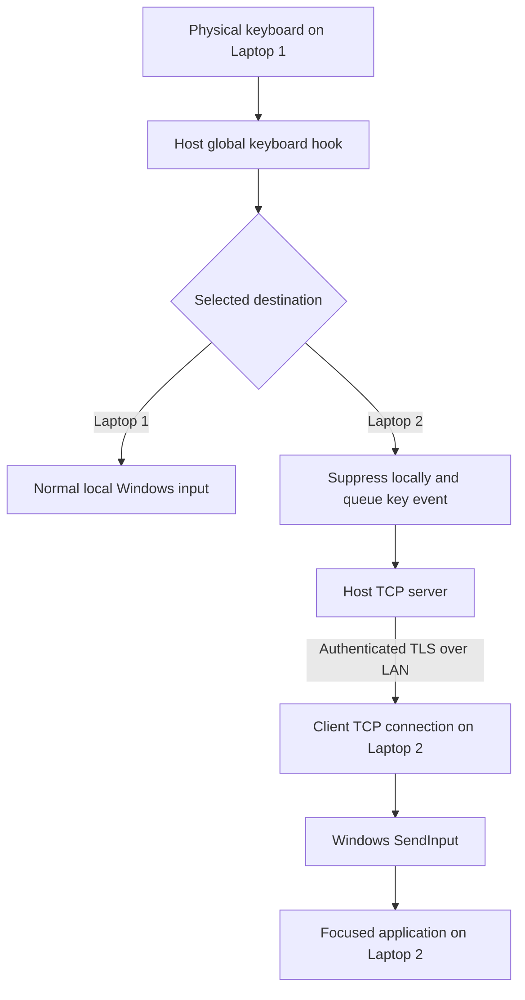

# KeyboardShare


[](LICENSE)

**Share one physical keyboard between two Windows computers over your local network.**

KeyboardShare is a small system-tray application with Host and Client modes. Leave your keyboard connected to Laptop 1, then use a shortcut to choose which laptop receives your typing. No mouse sharing is included.

## Why it exists

This project was created because Microsoft PowerToys Mouse Without Borders worked for mouse sharing, but keyboard forwarding was unreliable in the author's particular two-laptop setup. KeyboardShare provides a separate keyboard-sharing path for that workflow; it does not claim to be universally more reliable than PowerToys.

- **Mouse → PowerToys Mouse Without Borders**
- **Keyboard → KeyboardShare**

KeyboardShare is independent, unaffiliated with and not endorsed by Microsoft. Read the [compatibility note](#using-mouse-without-borders) before enabling both applications.

## DHCP update: version 1.0.1

Previously, a DHCP address change could leave sharing disconnected because saved peer addresses no longer matched. This update accepts computer names and resolves them again during reconnect and incoming peer checks. Existing IP-based configuration and shared tokens remain compatible.

To upgrade, install the new app on both laptops, enter the **other laptop's computer name** in **Other laptop name / IP** on each, keep **Host listen IP** at `0.0.0.0`, and update any single-IP firewall rule using the [DHCP firewall instructions](#windows-firewall). The LAN must resolve both names to their current addresses; DNS caching can delay recovery. If name resolution is unavailable, use router DHCP reservations instead.

The update adds regression checks for changing addresses and failed lookups. Token authentication remains required, and reconnect still leaves keyboard control on Laptop 1 until you deliberately switch remotely.

## Features

- One Windows tray executable for both Host and Client.
- Configurable local/remote shortcuts, plus a fixed emergency-return shortcut.
- Physical key-down/key-up forwarding with scan codes, extended-key information, and key repeat.
- Physical typing suppressed locally when remote is selected; injected events ignored by the capture hook.
- Tracked-key release on switching and session cleanup to reduce stuck modifiers.
- TCP with `NoDelay`, TLS encryption, mutual shared-token authentication, and peer-IP filtering.
- Automatic Client reconnect attempts and local fallback after a detected disconnect.
- Computer-name addressing, resolved again during reconnect and incoming peer checks, for networks using DHCP.
- Saved per-user settings, tray connection/target status, and rotating diagnostic logs.

This is a two-computer keyboard utility, not a full KVM. It does not provide clipboard, file, audio, or mouse sharing.

## Requirements

| To run | To build |
| --- | --- |
| Two Windows 10/11 x64 computers on a trusted LAN | Windows and the .NET 8 SDK |
| A physical keyboard connected to Laptop 1 | Git is optional for a downloaded source ZIP |
| A focused application on Laptop 2 | No third-party NuGet application dependencies |
| A permitted TCP connection to Laptop 1 | Run commands from the repository root |

The self-contained release includes .NET. Users do not need Visual Studio or a separately installed runtime. See [known limitations](#known-limitations) for Windows privilege and desktop restrictions.

## Installation

1. Open this repository's **Releases** page and download the Windows x64 ZIP when a release is available. GitHub's automatic **Source code** ZIP contains source, not a ready-to-run executable.
2. Extract it to a permanent folder on **both** laptops, for example `C:\Tools\KeyboardShare`. Keep the included license/notice files with the distribution.
3. Run **`KeyboardShare.exe` on both laptops**. The same file provides both modes.
4. Settings open on first run. Later, double-click the tray icon to open Settings. Use the taskbar's hidden-icons arrow if necessary.

The application is unsigned; Windows may show a reputation warning. There is no installer, startup registration, or automatic firewall modification. If no binary release exists, use [building from source](#building-from-source).

To update, exit the existing tray app, replace its files, and launch it again. Saved settings remain in your Windows profile. Keep both laptops on the same release; protocol version negotiation is not implemented.

## First-time setup

### Find both computer names (recommended for DHCP)

On each laptop run:

```powershell
hostname
```

The Settings help text also shows **This computer: NAME**. Enter the **other** laptop's name in **Other laptop name / IP** on each computer. Names remain stable when DHCP assigns a new address. For example, Host uses `LAPTOP-CLIENT` and Client uses `LAPTOP-HOST`; replace these example names with your actual names.

Both names must resolve on your LAN through Windows name resolution/DNS. To check from each laptop, run `ping OTHER-COMPUTER-NAME` and see whether Windows displays its current address. A blocked ping reply alone does not mean resolution failed. The app asks Windows for current addresses on every reconnect attempt and incoming peer check; Windows/router DNS caching can delay address updates. There is no custom broadcast discovery service.

Keep **Host listen IP** at `0.0.0.0` and use the DHCP-compatible firewall scope described below. If your network cannot resolve computer names reliably, use router DHCP reservations and fixed-IP configuration instead.

### IP-address alternative

On each laptop, open Command Prompt or PowerShell and run:

```powershell
ipconfig
```

Find the IPv4 address of the Wi-Fi/Ethernet connection they share. These addresses are **examples only**:

| Computer | Role | Example address |
| --- | --- | --- |
| Laptop 1, physical keyboard attached | Host / TCP server | `192.168.1.10` |
| Laptop 2, receives typing | Client / TCP connector | `192.168.1.20` |

Use your actual addresses. Router DHCP reservations help keep them stable. Guest Wi-Fi/client isolation can prevent communication even on the same network name.

### Laptop 1: Host

1. In Settings select **Host**.
2. Set **Other laptop name / IP** to Laptop 2's computer name (recommended for DHCP), or its reserved IP address.
3. Leave **Host listen IP** as `0.0.0.0` for IPv4 interfaces. A specific bind IP is suitable only if that address remains assigned to the Host.
4. Leave **TCP port** as `45832`, unless you need another port.
5. Leave the randomly generated **Shared token** in place. Check **Show token** to reveal it, then copy it to Laptop 2 through a trusted channel. Treat it as a password; never publish it in screenshots.
6. Leave the hotkeys at their defaults initially.
7. Select **Save and start**, then configure the [Host firewall rule](#windows-firewall).

### Laptop 2: Client

1. In Settings select **Client**.
2. Set **Other laptop name / IP** to Laptop 1's computer name (recommended for DHCP), or its reserved IP address.
3. Use the same **TCP port** as the Host.
4. Replace the Client's generated **Shared token** with the exact token copied from the Host.
5. Leave **Host listen IP** unchanged; Client networking ignores it. The hotkey fields are only used in Host mode.
6. Select **Save and start**. The Client attempts to connect automatically.

Hover over both tray icons: they should show **Connected**. Focus an application on Laptop 2, press **Ctrl+Alt+2 on Laptop 1**, release the chord, and type. Press **Ctrl+Alt+1** to return locally. Settings survive shutdown; start the app after signing in or configure [automatic startup](#start-with-windows).

## Keyboard shortcuts

Recognized on the **Host's physical keyboard** while the app is running on the normal interactive desktop:

| Shortcut | Action | Configurable? |
| --- | --- | --- |
| **Ctrl+Alt+1** | Select Laptop 1 | Yes; `Control+Alt+D1` by default |
| **Ctrl+Alt+2** | Select Laptop 2, when connected | Yes; `Control+Alt+D2` by default |
| **Ctrl+Alt+Esc** | Emergency return to Laptop 1 | No |

Release all held keys after switching. The app releases tracked keys on the old destination and suppresses keys held during the switch until physical release. You can also switch using the Host tray menu. Remote selection is unavailable while disconnected.

Use modifier names `Control` (or `Ctrl`), `Alt`, `Shift`, and/or `Win`, plus one Windows Forms key name, separated by `+`. Examples: `Control+Shift+F10`, `Win+Alt+F9`, `Control+Alt+NumPad2`. `D1` means top-row 1; `NumPad1` means numpad 1. Switch shortcuts must be distinct and cannot equal the emergency shortcut. Avoid conflicts with Windows/other utilities. Matching requires the configured modifiers; extra held modifiers can prevent a match.

## Configuration and tray controls

| Setting | Meaning / default |
| --- | --- |
| Mode | `Host` listens and captures; `Client` connects and injects |
| Other laptop name / IP (`PeerIP`) | Other computer's name or literal IP; initial `192.168.1.2` is a placeholder to replace |
| Host listen IP (`BindIP`) | Host bind address; default `0.0.0.0`; ignored by Client networking |
| TCP port | Default `45832`; allowed range `1024`–`65535` |
| Shared token | Initially 32 random bytes encoded as Base64; same on both; minimum 32 characters |
| Laptop 1 hotkey | Default `Control+Alt+D1` |
| Laptop 2 hotkey | Default `Control+Alt+D2` |

Use IPv4 for the documented setup. Peer names may be short Windows computer names or fully qualified DNS names, without a URL prefix or port. Host listen IP still requires a literal IP; local interfaces and address families must be compatible. All fields are validated on save, including listen-IP/hotkeys in Client mode. Long predictable tokens can pass validation; use the generated random token.

Settings live in `%LOCALAPPDATA%\KeyboardShare\config.json` for the current Windows user, including the token in **plaintext**. Saving restarts networking. Opening Host settings first returns control locally. Never share the settings file. Existing IP-based settings and tokens remain compatible; change the peer field to a resolvable name on both machines to tolerate DHCP changes. Fixed-IP settings/firewall rules still require updates if an address changes.

Right-click the tray icon for:

- **Keyboard → Laptop 1 / Laptop 2:** Host switching actions; disabled in Client mode.
- **Settings…:** edit configuration.
- **Open logs:** open the application-data folder.
- **Exit:** stop sharing and close the app.

Hover text shows **Connected / Disconnected** and **Keyboard → Laptop 1 / Laptop 2**. One instance is allowed per Windows session. If you see “already running,” use the existing tray icon.

## Architecture



The **Client initiates the TCP connection to the Host**, although keyboard events flow Host → Client. No mouse capture/injection occurs; the native mouse structure exists only to give the Windows `INPUT` union its required layout.

| Source | Responsibility |
| --- | --- |
| `KeyboardShare/Program.cs` | Tray, settings UI, logs, lock/suspend lifecycle |
| `KeyboardShare/Config.cs` | JSON settings, token generation, validation, hotkey parsing |
| `KeyboardShare/KeyboardRouter.cs` | `WH_KEYBOARD_LL` hook, physical-key state, suppression, switching |
| `KeyboardShare/Network.cs` | TCP/TLS, peer filtering, authentication, framing, reconnect |
| `KeyboardShare/PeerAddress.cs` | Per-attempt name resolution and normalized address matching |
| `KeyboardShare/Native.cs` | Win32 interop, `SendInput`, injected-key tracking and cleanup |
| `KeyboardShare.Tests/Program.cs` | Configuration/authentication/loopback console checks |

### Capture, switching, and injection

The Host low-level keyboard hook forwards normal input locally by default and ignores injected events. With Laptop 2 selected, it consumes physical events locally and queues virtual key, scan code, extended flag, and up/down state. Switching queues a release-all boundary and target-state message; the Host also releases tracked local keys. The Client tracks injected key-downs for corresponding key-ups during cleanup. Most keys use scan-code injection; Pause uses a virtual-key fallback.

### Transport and authentication

Before TLS, the Host resolves the configured Client name (or uses its literal IP) and checks the incoming address against that result. Failed resolution rejects the attempt without stopping the listener. `SslStream` permits TLS 1.2/1.3, using a self-signed RSA-2048 Host certificate generated at startup. Authentication exchanges fresh 32-byte nonces and HMAC-SHA256 proofs over the server/client nonces and TLS server certificate hash, with distinct role bytes. The HMAC key is SHA-256 of the UTF-8 token. Received proofs use fixed-time comparison. Both sides authenticate before processing input.

Certificate trust comes from this token proof, **not** CA/hostname validation; see [SECURITY.md](SECURITY.md). IP filtering supplements authentication. This custom protocol has not been independently audited.

Packets are six bytes: heartbeat (`0`), key (`1`), release-all (`2`), selected target (`3`). One asynchronous writer owns each TLS stream. TCP `NoDelay` is enabled; the hook uses nonblocking enqueue into a bounded 1,024-frame channel. Queue overflow closes the connection instead of blocking the keyboard callback.

### Connection recovery

The Host handles one Client session at a time. Each Client attempt resolves the Host name afresh and tries its returned addresses, with a two-second deadline per address within a five-second total resolution/connect deadline. A separate five-second combined TLS/token-authentication deadline follows. Incoming peer-name resolution also has a five-second deadline. The Client waits 1.5 seconds after a failed/ended attempt before retrying. An idle writer sends heartbeats about every 500 ms. Each incoming frame has a three-second read deadline; writes have a two-second deadline. Detection time depends on traffic, DNS caching, and scheduling; these are not real-time guarantees.

On detected disconnect the Host returns locally and the Client attempts to release injected held keys. Reconnection does **not** select Laptop 2 automatically. Lock/suspend stops sharing; unlock/resume restarts networking locally. Host listener startup errors are logged; fix the problem and Save and start or restart the app to retry.

## Start with Windows

On **each laptop**:

1. Keep the executable in a permanent folder.
2. Press **Win+R**, enter `shell:startup`, and press Enter.
3. Put a **shortcut to `KeyboardShare.exe`** there.

It launches after that user signs in, loads settings, and reconnects. Control starts locally. This does not run before sign-in or grant administrator privileges. If elevation is needed, configure a Task Scheduler task at logon for the interactive user with **Run with highest privileges** instead. Update shortcuts/tasks if the executable moves.

## Windows Firewall

Only **Host / Laptop 1** needs an inbound exception. For DHCP, allow the trusted local subnet rather than one changing Client IP. On Laptop 1 open PowerShell as Administrator; adapt the executable path and port:

```powershell
New-NetFirewallRule -DisplayName 'KeyboardShare from Laptop 2' -Direction Inbound -Action Allow -Protocol TCP -LocalPort 45832 -Program 'C:\Tools\KeyboardShare\KeyboardShare.exe' -RemoteAddress LocalSubnet -Profile Private
```

`LocalSubnet` allows other computers on directly connected subnets to attempt a connection, so use it only on trusted Private networks. The application still rejects addresses that do not resolve from the configured peer name and requires the shared token. For a reserved/static Client address, replace `LocalSubnet` with that single IP for a narrower firewall scope. Avoid Public-network exceptions; review Windows-prompt-created rules. No inbound exception is needed on Client. Networks restricting outbound traffic need an outbound allowance from Client to Host on that port.

If you already created the old single-IP rule, update it for DHCP instead of adding a duplicate:

```powershell
Set-NetFirewallRule -DisplayName 'KeyboardShare from Laptop 2' -RemoteAddress LocalSubnet
```

Change the rule if the program path/port changes, or if a single-IP scope no longer matches. Never expose the listening port via router internet forwarding. Remove the rule with:

```powershell
Remove-NetFirewallRule -DisplayName 'KeyboardShare from Laptop 2'
```

## Security considerations

Use trusted endpoints and a trusted LAN. Copy the random token securely, keep it private, and rotate it on both computers if exposed. It is stored unencrypted in the user profile. The Host can control applications on the Client. Restrict the firewall to a reserved peer IP or a trusted local subnet for DHCP. Name resolution is not authentication; the shared-token proof remains mandatory even if DNS is spoofed. Never publish personal settings, unmasked screenshots, or unsanitized logs.

Keystrokes and tokens are not intentionally logged; exception logs may contain local paths/network details. Logs rotate after approximately 1 MB to one `.old` backup. Read [SECURITY.md](SECURITY.md) for authentication, limitations, and private vulnerability reporting.

## Using Mouse Without Borders

KeyboardShare does not move the mouse, install mouse hooks, or change PowerToys settings. Retain Mouse Without Borders for mouse sharing **provided it does not independently forward the same keyboard stream**.

Mouse Without Borders also shares keyboards. Two simultaneous forwarders can duplicate input or compete through hooks. Test with the mouse over each computer. If your PowerToys setup cannot separate these behaviors, adjust/disable its keyboard forwarding or use a mouse-only sharing configuration/tool. KeyboardShare cannot guarantee duplicate-free operation alongside another active keyboard forwarder. Ignoring injected events prevents its own software-input forwarding loops but does not control other software's hooks/network traffic.

## Troubleshooting

| Symptom | What to check |
| --- | --- |
| Already running | Find the existing tray icon using the taskbar's hidden-icons arrow |
| Disconnected | Correct roles/peer names or addresses, name resolution on both laptops, identical tokens/ports, Host listening, firewall profile/rule |
| Connected but no typing | Ctrl+Alt+2 on Host, release chord, focus Client app, check elevation |
| Duplicate characters | Another keyboard forwarder, including Mouse Without Borders |
| Wrong symbols/numpad | Match layouts and initial Caps Lock/Num Lock states |
| Shortcut does not switch | Extra modifiers, configured key names, conflicts, remote disconnected |
| Save not visible | Use the fixed footer; scroll fields/resize. Enter activates Save and start |
| Failure after IP change | Use the other computer's resolvable name on both, wildcard Host listen IP, and DHCP-compatible firewall scope; otherwise reserve addresses on the router |
| Host port occupied | Choose an unused port on both and update firewall; Save and start |
| Held key after crash | Physically tap/release the modifier on Client; restart apps if needed |

Use **Open logs** to inspect `%LOCALAPPDATA%\KeyboardShare\app.log`. Redact private data before sharing. There is no LAN discovery, automatic firewall setup, or connection wizard.

## Known limitations

- One Host and one Client; no driver, service, or multi-Client broadcast.
- Normal desktop use needs no Administrator privileges. Injecting into an elevated Client application requires running KeyboardShare elevated there. Elevating the Host may also be necessary with elevated local applications. Firewall setup needs elevation.
- Cannot send Ctrl+Alt+Delete or control UAC secure desktop, sign-in, or locked screens. Switching shortcuts need the normal interactive desktop. Some games/security tools reject synthetic input.
- Key-release cleanup is attempted, but abrupt receiver termination or an inaccessible desktop can prevent it. There is no guarantee against every stuck-key scenario.
- Client layout interprets scan codes. Caps Lock/Num Lock states are not automatically synchronized. IMEs, unusual hardware, and Fn/media keys need testing; some Fn actions never reach Windows.
- Only physical Host events are routed. Software-injected events are ignored and not suppressed by this app. Each laptop's own physical keyboard remains usable.
- Device compatibility, hook suppression, and actual injection require real desktop testing; automated checks do not cover them.
- No automatic updates, protocol negotiation, independent security audit, or general-purpose denial-of-service protection.

Windows API references: [LowLevelKeyboardProc](https://learn.microsoft.com/en-us/windows/win32/winmsg/lowlevelkeyboardproc), [SendInput](https://learn.microsoft.com/en-us/windows/win32/api/winuser/nf-winuser-sendinput).

## Building from source

Install the .NET 8 SDK on Windows. Clone/download the repository and open PowerShell in its root:

```powershell
dotnet build KeyboardShare/KeyboardShare.csproj -c Release
dotnet run --project KeyboardShare.Tests/KeyboardShare.Tests.csproj -c Release
```

Framework-dependent output is `KeyboardShare/bin/Release/net8.0-windows/`; it needs the .NET 8 Windows Desktop Runtime. Use self-contained publishing for distribution.

The console harness checks config/hotkeys, token/role/transcript proofs, loopback TLS rejection/success, release packets, heartbeats, disconnect/reconnect, hostname validation/resolution, failed lookups, peer address changes, and reconnect to a moved loopback Host without changing saved peer names. It exits nonzero on failure and injects no keys. Use `dotnet run`; this is not a `dotnet test` framework project.

The [Windows CI workflow](.github/workflows/build.yml) builds with warnings as errors, runs checks, and verifies packaging on pushes/PRs. It never publishes a release. Local success does not mean hosted CI has already run.

### Manual acceptance checks

Before releasing, use two real Windows computers:

- In Notepad on both, verify local typing stays local and remote typing appears exactly once only on Client.
- Test left/right Shift/Ctrl/Alt/Win, repeat, navigation, F keys, numpad with both Num Lock states, Ctrl+C/V/Z, and Alt+Tab.
- Hold a key/modifier while switching each way and with emergency return. Release the chord and verify neither destination retains held keys.
- Drop LAN while holding a remote key. Check Client release attempts, Host local fallback, reconnect, and deliberate remote reselection.
- Configure computer names on both, renew DHCP addresses, and verify the names resolve to the new addresses and sharing reconnects without editing settings. Verify the firewall and wildcard Host bind still allow the connection.
- Repeat through sleep/wake, lock/unlock, wrong tokens/IPs, standard/elevated apps, and real layouts.
- Repeat with Mouse Without Borders and the mouse over each computer; confirm it does not also forward keystrokes.

## Publishing a self-contained Windows build

This produces one self-contained executable without changing input/network behavior:

```powershell
dotnet publish KeyboardShare/KeyboardShare.csproj -c Release -r win-x64 --self-contained true -p:PublishSingleFile=true -p:IncludeNativeLibrariesForSelfExtract=true -p:DebugType=None -p:DebugSymbols=false -p:ContinuousIntegrationBuild=true -o publish/release/win-x64
```

Run **`publish/release/win-x64/KeyboardShare.exe`** on both laptops. Native components extract to the user's temp directory. Exit a running copy from that location before republishing. No trimming/obfuscation is enabled.

For a ZIP containing the executable, docs, application license, and restored .NET runtime licenses/notices:

```powershell
powershell -NoProfile -ExecutionPolicy Bypass -File ./scripts/Publish.ps1
```

The policy override affects only this PowerShell process. The script reads the version from `KeyboardShare.csproj`, publishes, packages an explicit allowlist, and creates:

- `publish/release/KeyboardShare-<version>-win-x64.zip`
- `publish/release/KeyboardShare-<version>-win-x64.zip.sha256`

If the default executable is running and locked, pass `-OutputDirectory publish/release/1.0.1/win-x64` to publish a separate copy. The ZIP/checksum still appear directly in `publish/release/`.

Upload **the ZIP and checksum** as GitHub Release assets. Do not upload the workspace, `bin/`, `obj/`, personal settings, or logs. Prefer ZIP over a bare EXE so required notices accompany it. A checksum is not a publisher signature. See [PUBLICATION.md](PUBLICATION.md) for first-publication steps.

## Contributing

Bug reports, focused fixes, and device testing are welcome. Read [CONTRIBUTING.md](CONTRIBUTING.md) for build/test and PR expectations. Report vulnerabilities privately through [SECURITY.md](SECURITY.md).

## License

Application source is under the [MIT License](LICENSE), attributed to KeyboardShare contributors. There are no explicit third-party NuGet application dependencies. Self-contained releases include .NET components under their respective licenses; the packaging script preserves the restored runtime packs' license/notice files in `LICENSES/`.
